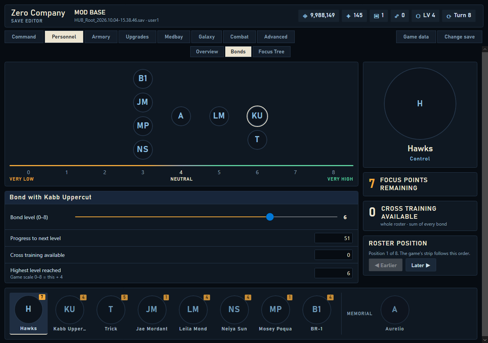

# Zero Company Save Editor

Edit your **Star Wars: Zero Company** save: credits, focus points, bonds, upgrades, the roster, even the units in a fight, in
an app that looks like the game. Every change is backed up and checked before it is written.

> **Unofficial fan project**, not affiliated with Disney, Lucasfilm, Electronic Arts or Bit Reactor. No game content is
> included. Editing saves is at your own risk: please read the [disclaimer](DISCLAIMER.md) and keep your own backups.
> For offline, single-player use.

   Bonds screen" width="900">

## Get started
1. **Download** the file for your system from the [Releases](https://github.com/starmast/zero-company-save-editor/releases)
   page, unpack it and run `ZeroCompanyEditor`. Nothing needs installing.
2. **Close the game**, then pick a save. On Windows your saves are found automatically; otherwise use **Add folder**.
3. **Make your changes** and press **Apply to save**. Edits stay pending until then, and a backup is made first.

Tip: copy a save somewhere first and try your edits on the copy. Load it in the game, and only then edit the real one.

The download also has `zc`, a command line tool that reads and edits saves the same way the editor does (`zc --help`; see
[docs/development.md](docs/development.md#the-sdk-and-zc)).

Optional but nice: open the **Game data** tab once to show real item names and upgrade costs instead of internal names
([how](docs/game-data.md); you also need a
free community [mappings file](https://www.nexusmods.com/starwarszerocompany/mods/99?tab=description)).

## What you can do
- **Command** - turn, level, XP, credits and other resources, roster capacity, gear slots, field tasks, the Black Market and the
  campaign options a game 1.2 campaign was started with (permadeath, injuries, risk of death ...); restore any backup.
- **Weapons** - see each operator's weapon and its parts, and copy a working weapon onto one that lost its data (a mod weapon the game could no longer load).
- **Personnel** - focus points, bonds, ability levels, give an operator an ability another one has or any bond trait (the class traits
  normally learned through cross training), roster order, bring back fallen operators.
- **Upgrades** - start base upgrades and optionally finish them at the next turn change.
- **Armory** (including adding items you never had), **Galaxy** (influence and claimed zone rewards, operations, Den missions, Coil upgrades), **Medbay** (heal injuries) and **Advanced** (every raw value).
- **Profile** - open the game's shared profile file to see every achievement's count and target, change the counts, and start the ones not counted yet.
- **Combat** - open a save made during a fight to edit every unit (health, action points, position, effects, team), mission
  objectives, countdown timers, reinforcements, fire zones and destructible scenery, the enemy threat tier, and bring more of your roster into the fight. Newer than the
  rest: try it on a copy first ([limits](docs/limitations.md#combat-tab)).

See the [user guide](docs/user-guide.md) for each screen in detail.

## Staying safe
Before anything is written the editor keeps an untouched copy of your save, snapshots the current file, and checks the
result. It won't write while the game is running or if the save changed since you opened it. "Save as copy" never touches
the original. Details are in [docs/safety.md](docs/safety.md).

Checked against game 1.2 (build 199049). If a later game update changes the save format, the editor refuses to write
what it cannot verify; keep your backups.

## Windows, Linux and macOS
Windows is the main platform. Linux and macOS builds exist but are less tested, and macOS can't extract game data itself.
See [docs/platforms.md](docs/platforms.md).

## More
| | |
|---|---|
| [User guide](docs/user-guide.md) | every screen and feature |
| [Game data](docs/game-data.md) | extracting names and costs from your own install |
| [Safety and how it works](docs/safety.md) | backups, verification, what gets edited |
| [Platforms](docs/platforms.md) | Windows, Linux, macOS notes and data folders |
| [Limitations](docs/limitations.md) | what it can't do yet |
| [Development](docs/development.md) | building, testing, project layout, credits |
| [Changelog](CHANGELOG.md) | what changed in each version |

Found a problem or have an idea? [Open an issue](https://github.com/starmast/zero-company-save-editor/issues/new/choose).
For a bug, **Copy debug report** (on the error banner, or **Game data > Report a problem**) gives the details to paste; when the save itself is
needed, **Save debug bundle…** zips the report with the save. Please do **not** attach game files, extracted game data or `.usmap` files.

## License
Source code: [MIT](LICENSE). The license covers this repository's code only; see [DISCLAIMER.md](DISCLAIMER.md) for
everything else.
