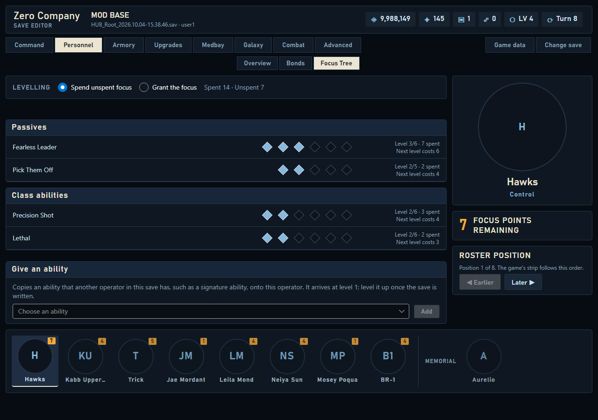
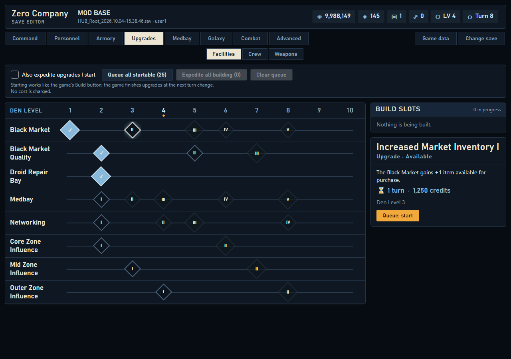

# User guide

How each screen works. Everything you change stays **pending** (shown in the bar at the bottom, with a list of what will
change) until you press **Apply to save**. **Discard** drops it all; **Save as copy** writes a separate file and leaves your
save alone (type a name in the box beside it so the copy is easy to tell apart in the game's load menu). The game lists its saves once, when it starts, so a copy written while the game is running only appears in the load menu after you restart the game.

## Opening a save
The **Saves** page lists the folders the editor knows about, each save with its in-game screenshot, name and turn. Use
**Add folder...** to point it at any other folder of `.sav` files. Settings and databank files can't be edited and are
listed as such.

The bar at the top shows your credits, intel, other resources, level and turn. Click any of them to type a new value.

## Command
Save details, the campaign values and the stockpile, then the Den and campaign settings, and your **backups**.

- **Campaign**: strategy turn, roster level and XP, **roster capacity** (how many operators the roster holds; it is also what the
  Recruitment screen checks, so raising it lets you recruit past the Den's limit), base focus points, **field tasks per turn** (the
  most, and how many are left this turn), the Black Market's **refresh cost** and its **bonus items**.
- **Gear slots**: give every operator more utility slots (up to 12) or fill the weapon's four mod slots. Shown once the save has had
  a slot upgrade.
- **Black Market restock**: how many items a refresh rolls from each quality table (Basic, Superior, Exquisite) for weapon mods and
  for utility items.
- **Campaign options** (campaigns started in game 1.2 or later): the additional campaign options picked when the campaign started,
  such as permadeath, operator injuries, risk of death, Advantage rules, enemy critical hits, operator health gain and the
  specialization locks. The game fixes them at the start; here each one is a drop-down. Campaigns started before 1.2 have no
  options, so the panel is not shown for them ([limits](limitations.md)).
- **Backups**: press **Restore** on a backup to put it back; the current file is saved as a new backup first, so nothing is lost.

## Personnel
Pick an operator from the strip at the bottom. Hold and drag an operator's icon sideways (or use **Earlier / Later**) to change
the roster order; the game's own strip and mission select follow it.

- **Overview** - unspent focus points (the total moves with it so points spent stay the same) and training and stat effects.
- **Bonds** - partners placed on the game's 0-8 scale. Click a face to change that bond's level, progress or cross training.
- **Focus Tree** - set ability levels using the game's own focus costs. Choose **Spend unspent focus** (levelling costs
  what you have) or **Grant the focus** (levelling is free; the total rises to match).
- **Give a bond trait** (on the Overview) - adds one of the 32 class traits operators normally learn only from a bond partner of
  another class through cross training, such as a Scout's Difficult Target or a Soldier's Grenadier. Pick it from the list (it shows
  the game's description once the game data is extracted) and press **Add**; after you apply it is listed under training and stat
  effects, and the operator has the trait's ability in fights.
- **Give an ability** (on the Focus Tree) - copies an ability another operator in the save holds, such as Cly's Combat Jump
  jetpack, onto this operator. It arrives at level 1; level it up like any other once the save is written.
- **Complete tree** - shown when an operator (such as the tutorial operator) is missing the higher tiers of some abilities.
  It copies them from another operator who has the same abilities.
- **Memorial** - a fallen operator's page has **Bring back**, which returns them to the roster ([limits](limitations.md)).

## Upgrades

Facilities, Crew and Weapons rows on a Den Level 1-10 timeline. Click an upgrade to see its cost, duration and requirements,
then **Queue: start**. Starting works like the game's Build button: the game then builds it over its normal duration. Tick
**Also expedite upgrades I start** to have it finish at the next turn change instead, or use **Queue: expedite** on one that is
already building. No cost is charged. **Queue all startable** queues everything that can be started, **Expedite all building**
expedites everything under construction, and **Clear queue** drops the queued starts and expedites.

## Weapons
Each roster operator's weapon and its parts (type, base, barrel, stock, scope, cell, paint). A weapon whose parts have **no mesh or variant
data** is marked damaged. The game leaves a weapon like that behind when a mod's weapon stops loading, for example after a game update: the
Armory then shows no weapon and greys out *Equip mods*, *Change weapon* and *Customize appearance*.

**Repair weapon** queues giving the operator a copy of another operator's vanilla weapon of the same class (rifle, pistol, longarm or
repeater). Choose which operator to copy from, or leave it on *Automatic*; only operators with an undamaged weapon that uses no mod assets
are offered. **Apply to save** writes it. The operator keeps their own weapon slots and the old weapon is replaced, so a modded weapon is not
brought back, only replaced with a working one (a backup keeps the old one). Once the mod works again, change the weapon in the game.
From the command line: `zc save weapons <save>` lists weapons, and `zc edit do <save> repair-weapon <operator> [donor] --write` repairs one.
Try it on a copy first; it has not been confirmed in the game.

## Armory
Utility items and weapon mods, with how many you own. Use the search box to find one.

**Add items** is a tab for items you never had, such as the reward you did not pick from a meditation (Tel's Jedi Meditation
missions let you choose one of several utility items). It lists every utility item and weapon mod the game defines, marked
*never owned* or *owned n*; **+** queues a new copy and **Apply to save** puts it in your inventory. The save keeps each copy as its
own entry, so two of an item are two entries. The list is long (about 150 items), so the tab has filters and a sort: **Show** (all,
utility items, all weapon mods, or one mod slot such as Scope or Barrel), **Tier**, **Rarity**, **Never owned only**, **Queued only**,
and **Sort by** name, tier, rarity or fewest owned; the search box matches every word you type, in any order, against the name,
description, slot, rarity and the mission that rewards it, and **Clear filters** resets it all. Items that missions give carry a
*Reward: mission: choice* line, and **Show: Mission choice rewards** lists the ones tied to a choice. For the meditations, pick that
filter plus **Never owned only** to see the pair you passed up in each Jedi Meditation (for example Serenity and Listen Through
Chaos if you chose *Meditate on the Present*). The mission list comes from the game data, so extract it again after updating the
editor (**Game data** tab) to get it. It needs the [game data](game-data.md) (the item list comes from there), and it
can't add resources, which already have an editable amount. Adding an item has been confirmed working in the game; as with any edit, try it on a copy first.

## Galaxy
The Galaxy screen has four tabs.

**Influence**: each zone by its Holotable name, with its influence, contacts, reward index and a **Rewards claimed** checkbox per
influence tier (with the tier's influence and reward once the game data is extracted). A ticked tier is one whose reward you have claimed.
Untick it and the game offers the reward again on the Holotable, as long as the zone's influence still reaches that tier; lowering the
influence alone never unticks anything. For example, untick Zone Jenth's tier 3 to claim the Hutt Roulette Prize again.

**Operations**: the Holotable's operations by name, with "Expires in N of M cycles". **Longer** and
**Full time** give an operation that is about to expire more time; **Shorter** takes it away (both confirmed in the game). Operations
cannot be added, launched or completed from here.

**Missions**: the missions the Den offers. Each shows its in-game name, place, difficulty, the faction it normally fights and how long it
lasts (re-extract the game data to get these). **Shorter**, **Longer** and **Full time** change how long it has left before it expires (confirmed in the game).
A crisis mission also has a **Coil upgrade** drop-down: which permanent Coil upgrade the crisis is about ([limits](limitations.md)). Each available mission has an **Enemies** drop-down (for
example *Coil threat 10*, or a tier of another faction, marked "other faction"). The game decides who a mission spawns when it starts, so
change it here, apply, then launch the mission. Missions already launched or finished are shown but not editable. Confirmed working in the game.

**Coil upgrades**: the upgrades the enemy has gained from failed Crisis missions. **Remove** puts the crisis back to available (it can
be failed again), **Prevent** marks it as won. Both work on one upgrade or all at once.

## Medbay
Beds, the bacta tank, their costs, who is injured and who is in treatment. **Heal** removes an operator's injuries the way the
bacta tank does, for free and instantly.

## Combat
Open a save made **during a fight** (a combat autosave such as `Autosave_EncounterStart_...`, or a manual save you made in one).
On any other save this tab just says so. A header shows the save's name, and the buttons on the right of the sub-tabs are quick
actions for that tab.

- **Allies, Enemies, Friendly AI, Other** - one card per unit (*Other* holds units on no side, such as story holograms, whose team
  cannot be changed). Edit its **Health**, base max health, **action points**, movement points,
  **Advantage** and **position** (X Y Z in world units). Open **All stats** for every other base value (aim, attack, critical
  chance and so on) and **Effects** to remove an effect, change its stacks, or copy an effect from another unit. **Mark dead**
  sets the dead flag (**Revive** on a dead unit clears it). The **Team** dropdown moves a unit to another side: *Ally* (you control it), *Friendly AI* (friendly, but the
  game moves it, like a rescued VIP or an allied fighter) or *Enemy*. In a **three-way battle** (a mission with two hostile sides
  fighting each other as well as you, like Belly of the Beast) there is also *Enemy2*, the second hostile side, and units can be
  moved between the two ([limits](limitations.md#combat-tab)). Quick actions: **Heal allies to full** and **Enemies to 1 HP**
  (both enemy sides).
- **Objectives** - each mission objective with its status; **Mark succeeded** or **Set back to active**. Counters such as
  occupy-region points and interactions are editable too. Above them, **Timers** show the turns left on a countdown, what it
  fails or starts when it runs out, and let you change the turns left and the total.
- **Roster** - operators of your roster who are not in this fight, each with **Bring into the fight** (and **Bring in everyone**). The game
  spawns them with your squad when the save loads, with the health the roster records; the box above the list also queues the free Medbay heal for
  injured ones. The game places them itself near the start point and some land outside the playable area, so apply, load the save, save it in the
  game, open that save here and set their Position X Y Z (Allies tab) to a spot next to your squad.
- **Reinforcements** - the **current round** of the fight (the game saves it; you can change it), the waves already on their way (the round each arrives, its spawn group, **Cancel wave**), the encounter's
  wave definitions (numbered per encounter when a mission has several) (how many times each may spawn, how many times it has been triggered, group) and the triggers that start waves (switch off). **Mission
  settings** above them has the **enemy threat tier** the mission draws its units from (for example *Coil threat 10*; tiers of
  other factions are offered too, marked experimental) and, in a three-way battle, the **turn structure**. **The threat tier does nothing for
  the encounter you are in**: it is read when an encounter starts, so the enemies on the map and the waves in the save are already fixed
  (the editor says so next to the drop-down). It can only affect a later encounter that has not started. To change who turns up, edit
  the units or the groups in the wave definitions.
- **Scenery** - the fire zones (turns left: a fire goes out when it reaches 0; fires placed with the map start near 9999, fires started in
  the fight last a few turns) and **every destructible prop**
  the save tracks, not only the ones already hit (a real level has several hundred, so only the first 150 matches are drawn). Search by
  name, area or condition (every word must match), filter by *Intact / Damaged / Destroyed* or by what you have queued, and use
  **Destroy** or **Restore** on a prop. **Destroy all N shown** and **Restore all N shown** act on every prop the search and filters
  match (not only the 150 on screen), so you can wreck all the cover in one area, or everything. A prop is wrecked or rebuilt by a state
  mark in its save record, not by its health, so these rewrite that mark (and set health to 0 or full where the prop has a health
  entry). The **Restore scenery** button in the header restores every destroyed or damaged prop.

The game caps Health at each unit's real maximum when it loads the save, so typing a high value is a full heal. Changes are
pending like everywhere else: **Apply to save**, or **Save as copy** to try them first.

## Profile
The game keeps one profile file for all your campaigns, `SharedGameSettings.sav`, next to the saves. It is listed as **Profile:
achievements and unlocks**; opening it shows a **Profile** tab and **Advanced** only.

- **Achievements** - every achievement the game counts, with the counter it watches, the target, and whether the count reaches it. The
  count is editable. The game adds to these counts as you play (in any campaign) and checks them against the targets; loading an older
  save does not change them. A counter the game has not started yet shows "not counted yet" and a **Start at** box: type a count and
  apply to add the counter with that count; the game adds to it from there.
- **Best zone reward tier** - the highest influence tier reached in each galaxy zone across your campaigns.
- **Unlocks** - what the profile has unlocked for every campaign, such as story outfits.

The game rewrites this file while it runs, so close the game before applying, as with saves. EA and Steam keep their own record of
unlocked achievements.

## Advanced
Every editable value as a flat list, grouped the way the save stores it, with a filter, plus a raw property tree that lets you
edit numbers in place. Use with care.

## Game data
Real names, descriptions and costs; see [game-data.md](game-data.md).

## Reporting a problem
When something fails, the red banner has **Copy debug report** and **Save debug bundle…**; the same buttons are under **Game data > Report a
problem** at any time. The report lists the editor and game versions, the last error, your pending changes, counts from the open save (no
operator names), a **Mods** section (asset folders that come from mods, the weapon types in use, and a warning when a weapon, usually from a mod
that stopped loading, can no longer be built) and how your setup looks, with your home folder shown as `~`. Paste it into a
[bug report](https://github.com/starmast/zero-company-save-editor/issues/new/choose). The bundle is a zip of the report, the open save as it is
on disk (without pending edits) and the crash log, for problems that need the save itself.
